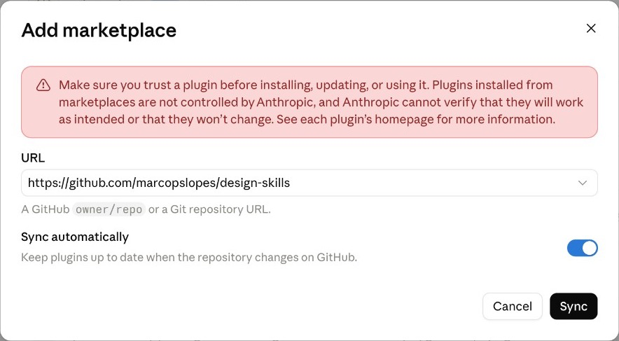

<p align="center">
  
</p>

# Design Skills

70 design workflows for the AI agent you already use. Free and open source.
Research a problem, shape the experience, build on your design system, and check
the work before you share it.

A skill is a written playbook your agent follows for one kind of design work: what
to bring, which steps to take, what to check, and what to hand back. You get the
same careful process every time instead of a fresh prompt.

**[Browse the skills](https://thedesignharness.com/skills.html) · [Get started](#get-started) · [The full Design Harness](https://github.com/marcopslopes/design-harness)**

## What you can do

- **Frame the problem.** Separate what the team knows from what it assumes, define the product's objects before drawing screens, and turn a vague request into a decision brief.
- **Run research.** Write screeners and test guides, synthesize interviews into evidence-backed patterns, and write insights that pass a so-what check.
- **Shape the experience.** Spec interaction states, motion, responsive behaviour, and product copy, with accessibility built in.
- **Build on your design system.** Compose screens from your real tokens and components, and keep Figma and code in sync.
- **Review before you share.** Critique flows, check accessibility, and review live pages and Figma files.
- **Explain and hand off.** Document the rationale, write handoff specs, and turn findings into reports and decks.

Install all 70 skills as one plugin, one workflow at a time, or a single skill.

## Get started

**In Claude (claude.ai or the desktop app).** Go to Customize → Plugins → Add →
**Add marketplace**, paste `https://github.com/marcopslopes/design-skills`, and click
**Sync**. Open **Design skills**, wait for the security scan to finish, then click
**Add**. Code execution must be on in Settings → Capabilities.



**In Claude Code:**

```text
/plugin marketplace add marcopslopes/design-skills
/plugin install design-skills@design-skills
```

**In Codex:** run `codex plugin marketplace add marcopslopes/design-skills`, then
install from `/plugins`.

**In Cursor or any other agent:**

```bash
npx skills add marcopslopes/design-skills
```

**In ChatGPT** (Business, Enterprise, and Edu), a workspace admin imports the same
GitHub URL under Admin console → Plugins → **Import marketplace**.

**Just one skill?** Every skill below has a ZIP you can upload under Skills in
Claude or ChatGPT, or add with `npx skills add marcopslopes/design-skills --skill <name>`.

Then ask for the work in plain words. Your agent picks the matching skill:

> Map the assumptions behind our new referral feature. Separate what we know from what we believe.

> Review this checkout flow against common UX patterns and flag anything that will confuse first-time users.

Most skills work best with your product context nearby: a brief, research notes,
your design tokens, or the screens you're reviewing.

## The skills

<details>
<summary><strong>Understand the problem</strong> · 10 skills</summary>

Frame the problem before designing: assumptions, objects, decisions, strategy, and priorities. Plugin: `design-understand` · [download zip](downloads/plugins/design-understand.zip)

| Skill | What it does | Single skill |
|---|---|---|
| [`assumption-mapper`](plugins/design-skills/skills/assumption-mapper/SKILL.md) | Separate what the team knows from what it assumes before research or building begins. | [ZIP](downloads/skills/assumption-mapper.zip) |
| [`conceptual-model`](plugins/design-skills/skills/conceptual-model/SKILL.md) | Define the product’s objects, relationships, states, and vocabulary before drawing screens. | [ZIP](downloads/skills/conceptual-model.zip) |
| [`decision-first-research`](plugins/design-skills/skills/decision-first-research/SKILL.md) | Turn a research request into a clear decision, the evidence it needs, and the smallest useful study. | [ZIP](downloads/skills/decision-first-research.zip) |
| [`design-kickoff`](plugins/design-skills/skills/design-kickoff/SKILL.md) | Turn a new request into a researched brief, with an approval step before building. | [ZIP](downloads/skills/design-kickoff.zip) |
| [`diagnostic`](plugins/design-skills/skills/diagnostic/SKILL.md) | Find the design bottleneck and decide which workflow to run next. | [ZIP](downloads/skills/diagnostic.zip) |
| [`okr-goal-setting`](plugins/design-skills/skills/okr-goal-setting/SKILL.md) | Define a measurable design goal connected to a real business outcome. | [ZIP](downloads/skills/okr-goal-setting.zip) |
| [`product-strategy`](plugins/design-skills/skills/product-strategy/SKILL.md) | Connect user opportunities to business outcomes and solution bets with an opportunity solution tree. | [ZIP](downloads/skills/product-strategy.zip) |
| [`roadmap-prioritization`](plugins/design-skills/skills/roadmap-prioritization/SKILL.md) | Rank design work using evidence, business goals, and an explicit effort appetite. | [ZIP](downloads/skills/roadmap-prioritization.zip) |
| [`stakeholder-alignment`](plugins/design-skills/skills/stakeholder-alignment/SKILL.md) | Identify who needs to agree, what matters to them, and the decision to ask for. | [ZIP](downloads/skills/stakeholder-alignment.zip) |
| [`workload-agent`](plugins/design-skills/skills/workload-agent/SKILL.md) | Check the live product roadmap and design workload from connected boards. | [ZIP](downloads/skills/workload-agent.zip) |

</details>

<details>
<summary><strong>Research and synthesize</strong> · 13 skills</summary>

Plan, run, and synthesize research: screeners, test guides, synthesis, insights, and share-outs. Plugin: `design-research` · [download zip](downloads/plugins/design-research.zip)

| Skill | What it does | Single skill |
|---|---|---|
| [`benchmark`](plugins/design-skills/skills/benchmark/SKILL.md) | Score your own flow against best-in-class examples and name the gaps worth closing. | [ZIP](downloads/skills/benchmark.zip) |
| [`competitor-scan`](plugins/design-skills/skills/competitor-scan/SKILL.md) | Find how one competitor handles a specific feature or flow. | [ZIP](downloads/skills/competitor-scan.zip) |
| [`ia-methods`](plugins/design-skills/skills/ia-methods/SKILL.md) | Plan and analyze card sorts and tree tests to check your information architecture. | [ZIP](downloads/skills/ia-methods.zip) |
| [`insight-writer`](plugins/design-skills/skills/insight-writer/SKILL.md) | Turn research patterns into insights that explain why they matter and what to do next. | [ZIP](downloads/skills/insight-writer.zip) |
| [`research-agent`](plugins/design-skills/skills/research-agent/SKILL.md) | Gather existing product knowledge and source evidence for a new design task. | [ZIP](downloads/skills/research-agent.zip) |
| [`research-artifacts`](plugins/design-skills/skills/research-artifacts/SKILL.md) | Build personas, journey maps, job stories, and service blueprints from real research. | [ZIP](downloads/skills/research-artifacts.zip) |
| [`research-question-sharpener`](plugins/design-skills/skills/research-question-sharpener/SKILL.md) | Rewrite vague research questions so they produce usable answers, and flag the ones research can’t answer. | [ZIP](downloads/skills/research-question-sharpener.zip) |
| [`research-shareout`](plugins/design-skills/skills/research-shareout/SKILL.md) | Plan how to share research so stakeholders engage and act on it. | [ZIP](downloads/skills/research-shareout.zip) |
| [`research-summary`](plugins/design-skills/skills/research-summary/SKILL.md) | Summarize a research session or study so the team can see the findings and next steps. | [ZIP](downloads/skills/research-summary.zip) |
| [`research-synthesis`](plugins/design-skills/skills/research-synthesis/SKILL.md) | Turn interview notes and transcripts into tagged evidence and pattern candidates. | [ZIP](downloads/skills/research-synthesis.zip) |
| [`screener-builder`](plugins/design-skills/skills/screener-builder/SKILL.md) | Write a recruitment screener that selects participants by behaviour, not demographics. | [ZIP](downloads/skills/screener-builder.zip) |
| [`usability-test-guide`](plugins/design-skills/skills/usability-test-guide/SKILL.md) | Prepare the tasks, questions, and measures for a usability test. | [ZIP](downloads/skills/usability-test-guide.zip) |
| [`workshop-whiteboard`](plugins/design-skills/skills/workshop-whiteboard/SKILL.md) | Run a timed research-scoping board with your team, from problem to plan. | [ZIP](downloads/skills/workshop-whiteboard.zip) |

</details>

<details>
<summary><strong>Shape the experience</strong> · 8 skills</summary>

Shape interaction, content, motion, accessibility, and responsive behaviour. Plugin: `design-shape` · [download zip](downloads/plugins/design-shape.zip)

| Skill | What it does | Single skill |
|---|---|---|
| [`accessibility-decisions`](plugins/design-skills/skills/accessibility-decisions/SKILL.md) | Record accessibility decisions and trade-offs, with handoff criteria engineering can build to. | [ZIP](downloads/skills/accessibility-decisions.zip) |
| [`adaptive-interfaces`](plugins/design-skills/skills/adaptive-interfaces/SKILL.md) | Spec how a screen responds to reduced motion, contrast, text size, and density preferences. | [ZIP](downloads/skills/adaptive-interfaces.zip) |
| [`cognitive-accessibility`](plugins/design-skills/skills/cognitive-accessibility/SKILL.md) | Check mental load, wayfinding, memory demands, and decision complexity, beyond contrast and ARIA. | [ZIP](downloads/skills/cognitive-accessibility.zip) |
| [`content`](plugins/design-skills/skills/content/SKILL.md) | Write and review interface copy against your product’s voice and terminology. | [ZIP](downloads/skills/content.zip) |
| [`inspiration-scouting`](plugins/design-skills/skills/inspiration-scouting/SKILL.md) | Collect visual and interaction references, with what to take and what to leave from each. | [ZIP](downloads/skills/inspiration-scouting.zip) |
| [`interaction-design`](plugins/design-skills/skills/interaction-design/SKILL.md) | Specify component states and feedback across keyboard, touch, and screen readers. | [ZIP](downloads/skills/interaction-design.zip) |
| [`motion-choreography`](plugins/design-skills/skills/motion-choreography/SKILL.md) | Spec, review, and plan purposeful animation, always with a reduced-motion alternative. | [ZIP](downloads/skills/motion-choreography.zip) |
| [`responsive-patterns`](plugins/design-skills/skills/responsive-patterns/SKILL.md) | Content-driven breakpoint strategy, reflow, priority shifting, and 200% zoom / WCAG 1.4.10 discipline for multi-width layouts. | [ZIP](downloads/skills/responsive-patterns.zip) |

</details>

<details>
<summary><strong>Build and prototype</strong> · 9 skills</summary>

Build screens on real design tokens and components, and keep Figma and code in sync. Plugin: `design-build` · [download zip](downloads/plugins/design-build.zip)

| Skill | What it does | Single skill |
|---|---|---|
| [`design-system`](plugins/design-skills/skills/design-system/SKILL.md) | Check whether a style value already exists as a token before anything is written. | [ZIP](downloads/skills/design-system.zip) |
| [`figma-asset-sync`](plugins/design-skills/skills/figma-asset-sync/SKILL.md) | Download icons and images from Figma and package them for code. | [ZIP](downloads/skills/figma-asset-sync.zip) |
| [`figma-code-sync`](plugins/design-skills/skills/figma-code-sync/SKILL.md) | Map Figma components to their code counterparts using Code Connect. | [ZIP](downloads/skills/figma-code-sync.zip) |
| [`figma-effects-catalog`](plugins/design-skills/skills/figma-effects-catalog/SKILL.md) | Document the custom shader effects and fills used in your Figma files. | [ZIP](downloads/skills/figma-effects-catalog.zip) |
| [`figma-library-manager`](plugins/design-skills/skills/figma-library-manager/SKILL.md) | Find existing library components before creating new ones in Figma. | [ZIP](downloads/skills/figma-library-manager.zip) |
| [`figma-token-sync`](plugins/design-skills/skills/figma-token-sync/SKILL.md) | Find drift between Figma variables and your code tokens, and sync them in either direction. | [ZIP](downloads/skills/figma-token-sync.zip) |
| [`icon-usage`](plugins/design-skills/skills/icon-usage/SKILL.md) | Use icons from your icon library through one component, never hand-drawn SVG. | [ZIP](downloads/skills/icon-usage.zip) |
| [`mobile-shell`](plugins/design-skills/skills/mobile-shell/SKILL.md) | Keep phone-frame prototypes consistent: status bar, navigation, tab bar, and sheets. | [ZIP](downloads/skills/mobile-shell.zip) |
| [`ui-agent`](plugins/design-skills/skills/ui-agent/SKILL.md) | Build a screen using your product’s design tokens and shared components. | [ZIP](downloads/skills/ui-agent.zip) |

</details>

<details>
<summary><strong>Review and validate</strong> · 10 skills</summary>

Critique and check work before sharing: UX patterns, accessibility, live pages, and audits. Plugin: `design-review` · [download zip](downloads/plugins/design-review.zip)

| Skill | What it does | Single skill |
|---|---|---|
| [`accessibility`](plugins/design-skills/skills/accessibility/SKILL.md) | Check semantics, labels, contrast, keyboard access, and focus before sharing. | [ZIP](downloads/skills/accessibility.zip) |
| [`audit`](plugins/design-skills/skills/audit/SKILL.md) | Check a prototype’s design system, accessibility, and copy before sharing. | [ZIP](downloads/skills/audit.zip) |
| [`critique-prep`](plugins/design-skills/skills/critique-prep/SKILL.md) | Write a presenter script for a design critique: framing, walk order, and the feedback you want. | [ZIP](downloads/skills/critique-prep.zip) |
| [`figma-ux-audit`](plugins/design-skills/skills/figma-ux-audit/SKILL.md) | Audit a Figma page and place colour-coded annotation cards next to each screen. | [ZIP](downloads/skills/figma-ux-audit.zip) |
| [`interface-change-review`](plugins/design-skills/skills/interface-change-review/SKILL.md) | Review only the UI you changed, and separate new issues from regressions and old ones. | [ZIP](downloads/skills/interface-change-review.zip) |
| [`live-page-review`](plugins/design-skills/skills/live-page-review/SKILL.md) | Capture a live page and route its evidence into the right review workflow. | [ZIP](downloads/skills/live-page-review.zip) |
| [`synthetic-user-testing`](plugins/design-skills/skills/synthetic-user-testing/SKILL.md) | Walk a prototype through key tasks as named personas to find friction before real testing. | [ZIP](downloads/skills/synthetic-user-testing.zip) |
| [`taste-feedback`](plugins/design-skills/skills/taste-feedback/SKILL.md) | Check visual density, weight, and hierarchy mid-build, before a full critique. | [ZIP](downloads/skills/taste-feedback.zip) |
| [`ux-pattern`](plugins/design-skills/skills/ux-pattern/SKILL.md) | Review a flow’s structure against how your product works, not just how it looks. | [ZIP](downloads/skills/ux-pattern.zip) |
| [`ux-review`](plugins/design-skills/skills/ux-review/SKILL.md) | Run a five-persona UX review on a URL, HTML file, screenshot, or Figma frame and get one scored report. | [ZIP](downloads/skills/ux-review.zip) |

</details>

<details>
<summary><strong>Explain and hand off</strong> · 6 skills</summary>

Explain decisions and hand work off: rationale, handoff specs, reports, decks, and writing. Plugin: `design-handoff` · [download zip](downloads/plugins/design-handoff.zip)

| Skill | What it does | Single skill |
|---|---|---|
| [`deck-builder`](plugins/design-skills/skills/deck-builder/SKILL.md) | Turn finished findings into a presentation deck, using only evidence from the project. | [ZIP](downloads/skills/deck-builder.zip) |
| [`design-handoff`](plugins/design-skills/skills/design-handoff/SKILL.md) | Capture layout, components, states, and edge cases in a draft engineering spec. | [ZIP](downloads/skills/design-handoff.zip) |
| [`design-rationale`](plugins/design-skills/skills/design-rationale/SKILL.md) | Record the options, evidence, and tradeoffs behind a design decision. | [ZIP](downloads/skills/design-rationale.zip) |
| [`review-report`](plugins/design-skills/skills/review-report/SKILL.md) | Turn a finished design critique into a readable HTML report. | [ZIP](downloads/skills/review-report.zip) |
| [`session-handoff`](plugins/design-skills/skills/session-handoff/SKILL.md) | Save the decisions and open questions so the next agent session can continue. | [ZIP](downloads/skills/session-handoff.zip) |
| [`writing`](plugins/design-skills/skills/writing/SKILL.md) | Write long-form pieces such as articles, essays, and case-study write-ups, with every claim sourced. | [ZIP](downloads/skills/writing.zip) |

</details>

<details>
<summary><strong>Run the design practice</strong> · 14 skills</summary>

Run the practice around the work: setup, memory, debt, scheduling, tickets, and team coaching. Plugin: `design-operate` · [download zip](downloads/plugins/design-operate.zip)

| Skill | What it does | Single skill |
|---|---|---|
| [`case-study`](plugins/design-skills/skills/case-study/SKILL.md) | Write a project case study from its brief, findings, and decisions, with every claim sourced. | [ZIP](downloads/skills/case-study.zip) |
| [`design-debt-tracker`](plugins/design-skills/skills/design-debt-tracker/SKILL.md) | Standalone triage and review of the per-project design debt register (projects/&lt;slug&gt;/debt.md). | [ZIP](downloads/skills/design-debt-tracker.zip) |
| [`design-memory`](plugins/design-skills/skills/design-memory/SKILL.md) | Keep a private record of how you tend to design across projects. | [ZIP](downloads/skills/design-memory.zip) |
| [`design-retrospective`](plugins/design-skills/skills/design-retrospective/SKILL.md) | Reflect on a shipped project: what worked, what didn’t, and what to carry forward. | [ZIP](downloads/skills/design-retrospective.zip) |
| [`designer-workload`](plugins/design-skills/skills/designer-workload/SKILL.md) | Older version of workload-agent, kept for compatibility. Use workload-agent instead. | [ZIP](downloads/skills/designer-workload.zip) |
| [`docs-brief`](plugins/design-skills/skills/docs-brief/SKILL.md) | Draft a short status or decision brief as a page in Confluence, Notion, or Google Docs. | [ZIP](downloads/skills/docs-brief.zip) |
| [`harness-setup`](plugins/design-skills/skills/harness-setup/SKILL.md) | Bring in your design system, brand guidelines, and company context, or start from the examples. | [ZIP](downloads/skills/harness-setup.zip) |
| [`manager-1on1-prep`](plugins/design-skills/skills/manager-1on1-prep/SKILL.md) | Prepare a 1:1 with a direct report from their live work and recent updates. | [ZIP](downloads/skills/manager-1on1-prep.zip) |
| [`org-pack-builder`](plugins/design-skills/skills/org-pack-builder/SKILL.md) | Gather your company context, vocabulary, voice, and patterns into files your agent can read. | [ZIP](downloads/skills/org-pack-builder.zip) |
| [`people-coaching`](plugins/design-skills/skills/people-coaching/SKILL.md) | Prepare feedback, a difficult conversation, or a growth plan for someone you manage. | [ZIP](downloads/skills/people-coaching.zip) |
| [`presenter`](plugins/design-skills/skills/presenter/SKILL.md) | Choose how to show built screens to a reviewer, then set up that view. | [ZIP](downloads/skills/presenter.zip) |
| [`publish-project`](plugins/design-skills/skills/publish-project/SKILL.md) | Publish a project’s share pages to a public link when you choose to. | [ZIP](downloads/skills/publish-project.zip) |
| [`scheduling`](plugins/design-skills/skills/scheduling/SKILL.md) | Find a meeting slot and draft the invite with real context from the project. | [ZIP](downloads/skills/scheduling.zip) |
| [`ticket-create`](plugins/design-skills/skills/ticket-create/SKILL.md) | Draft a ticket and file it in Jira, Linear, or GitHub Issues once you say go. | [ZIP](downloads/skills/ticket-create.zip) |

</details>

## Use them on their own or with the Harness

These skills come from the [Design Harness](https://github.com/marcopslopes/design-harness),
a complete design workspace with routing between skills, company context, and a
prototype app. Each skill also works on its own: a short
`references/standalone-mode.md` tells the agent what to use when the Harness files
aren't there, usually your own design system, a folder you pick, or a few questions.

## Feedback and contributing

Design Skills is an early release. Feedback about what worked, what broke, and which
workflow you wish existed helps improve it.

- [Report an issue](https://github.com/marcopslopes/design-skills/issues) — a skill breaks, gives a weak result, or a workflow is missing.
- [Contributing](CONTRIBUTING.md) — skills are generated from the Harness, so improvements go there as a pull request.
- [The Design Harness site](https://thedesignharness.com) — guides and the full skill library.

Created by **[Marco Paulo Lopes](https://github.com/marcopslopes)**. Version 0.1.0.

## License

[MIT](LICENSE).
