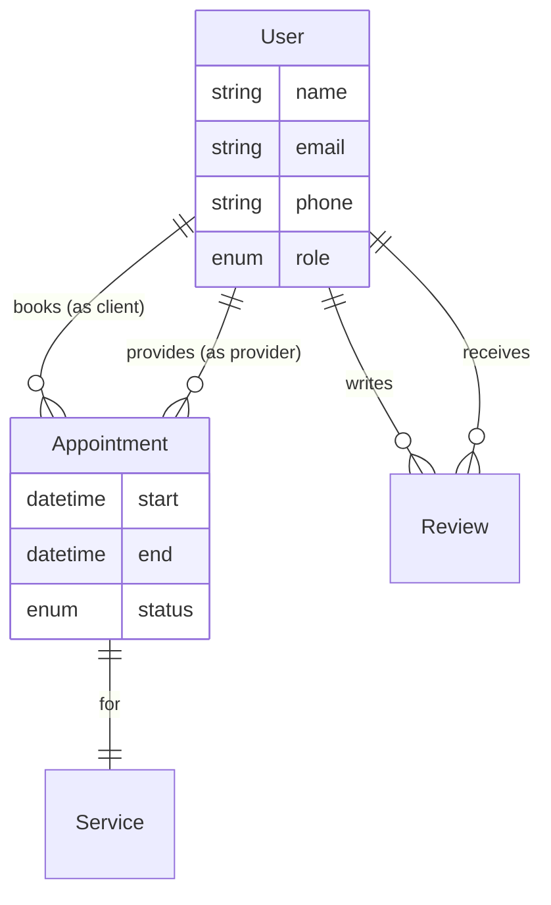
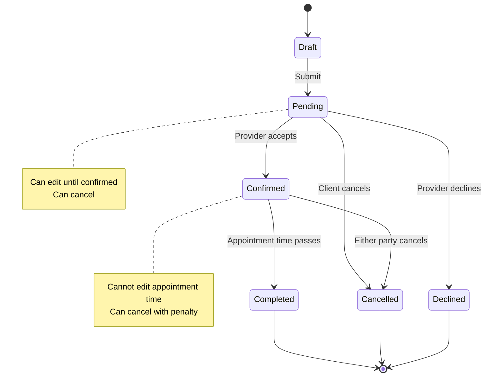

# Conceptual model

> **Design Skills package.** This skill comes from the Design Harness and works on its own. If a path it mentions isn't in your project, follow [references/standalone-mode.md](references/standalone-mode.md).

The conceptual model is the most neglected load-bearing layer. It defines
**what the product recognizes as existing**, **how those things relate**,
**what states they can be in**, and **the vocabulary for all of it** —
independent of any interface.

It is **not** the users' messy mental model (that's domain work), and
**not** a database schema, wireframe, or flow. But the gap between this
model and what engineers build matters: a large, unexamined gap creates
both UX debt (users meet a product that contradicts the model) and
technical debt (the system is hard to evolve).

**Invoke in Cursor:** "define the object model", "map relationships",
"what states can X be in", "ubiquitous language for this"

---

## When to use this skill

Run conceptual model work when:
- **Design kickoff completed** but before building screens — you know the
  problem and strategy, but haven't defined what the product will work with
- **Object boundaries are unclear** — "is this one thing or two separate
  things?"
- **Relationships are contested** — "how do these connect?"
- **Vocabulary is inconsistent** — same concept, different names across
  team/users
- **State transitions matter** — "what can happen to this thing over time?"
- **Domain work surfaced many nouns** — need to decide which become
  product objects

Don't run this when:
- Objects are obvious and uncontested (e.g. a simple CRUD screen for one
  well-understood entity)
- You're iterating visual design on an already-stable model
- Domain hasn't been mapped yet (do that first — see org-pack-builder for
  COMPANY-VOCABULARY or research-agent for user domain mapping)

---

## The decisions this layer makes

If none of these is genuinely open, you may not need this layer right now.
Say so rather than working it for the sake of it.

1. **What objects the product recognizes** — and where each object's
   boundary is
2. **How those objects relate** — cardinality (one-to-one, one-to-many)
   and named roles where an object plays several
3. **What a user can do to or with each object** — the action vocabulary
4. **What states an object can be in** — and which transitions matter to
   users
5. **The product's vocabulary** — one name per concept, one concept per
   name (ubiquitous language)
6. **Temporal decisions** — how time affects objects (history, deletion
   semantics, intermediate states, relationship changes over time)

---

## Disciplines — what keeps the model honest

Apply these to whatever you produce. They are the high-value part of this
layer.

### Real objects only

A true object is:
- **Instanceable** — you can have many of them
- **Structured** — has its own attributes (not just a label)
- **Useful** — users care about it in its own right (not just as metadata
  on something else)

This catches two common errors:

**Error 1: Attribute promoted to object**
- Bad: "Name" as an object
- Good: Name is an attribute of User

**Error 2: Instances mistaken for objects** (more common)
- Bad: "CAC", "ROAS", "LTV" modeled as separate objects
- Good: **Metric** is the object; "CAC"/"ROAS"/"LTV" are instances or
  values of that object

When several nouns are of-a-kind, model the **type** as the object; the
specific names are instances or values.

### Attributes that are really relationships

If an attribute is just the name or ID of another object in the model,
model it as a **relationship** — don't duplicate data across objects.

- Bad: User has a `referrerName` attribute
- Good: User `belongs to one User (as referrer)` relationship

### Name the role when an object plays several

When the same object type appears multiple times in different roles, name
the role explicitly:

- Bad: "Appointment belongs to one User"
- Good: "Appointment belongs to one User (as provider), one User (as client)"

### No speculative additions

Every object, attribute, action, and relationship should trace to a stated
user need from design-kickoff or research findings. Scope creep here
propagates through every layer above.

Tracing to *strategy vocabulary* doesn't count — strategy words aren't yet
objects until you've decided they should be.

### Can-be-an-object ≠ should-be-first-class

The "real objects only" test tells you something *can* be an object — not
that the product should commit to it as a first-class, persistent,
stateful entity.

**That elevation is a design bet with a cost.** Justify it by concrete
use: *what flow or job forces this thing to persist, hold state, and be
returned to?* If nothing does, it's transient, or it's premature.

When an object exists only because of an unvalidated strategy bet, mark it
**provisional** — model it as a hypothesis, don't "lock" it, and don't
build the layer above on it until the bet is tested.

### Verb precision

Does a generic verb (Edit, Delete, Update) hide operations with different
real-world consequences?

- Bad: "Edit address" conflates correcting a typo (overwrite is fine) with
  recording a house move (which should preserve history)
- Good: "Correct address" vs "Register change of address" — not verbose,
  it's precise

When a generic verb could mean genuinely different things, name the
operations separately.

### Implementation is not design

When talk drifts to how something is stored, generated, or computed,
redirect to **what the user can do** and **what happens to things that
referenced it**.

Flag genuinely entangled questions for an engineering conversation rather
than forcing a premature answer.

---

## Domain-mapping mode

**The gap this closes:** the noun-foraging technique below (Step 1)
already assumes you're deciding what the *product* will recognize as an
object. That's a solution-space decision. There's an earlier, looser pass
— mapping how the domain talks about itself *before any product exists*,
contradictions included — that this skill was skipping straight past.

**When this fires:** the domain is genuinely unmapped or contested —
multiple teams/user groups use different words for the same thing, the
domain is process-heavy and no one's laid out the events, or a
noun-foraging pass keeps stalling on "wait, what do we even call this?"
Skip this mode when the domain is already well understood and
uncontested — go straight to Step 0 below.

**Load `references/domain-mapping.md`**
and run its techniques (concept maps, terminology audit,
bounded-context mapping, domain event storming, noun harvest). The
governing discipline: **don't resolve contradictions — record them.**
Picking a winning term is `conceptual-model`'s job (Step 1's ubiquitous
language technique), not this mode's.

**Output:** a domain map (concept map / terminology audit / bounded
contexts / events / noun harvest — whichever techniques earned their
place). The noun harvest hands off directly into Step 1's noun-foraging
technique below.

---

## Step 0 — Find the live decisions (technique selection)

Don't run all techniques. Find which of the decisions above are actually
open, then pick the technique that fits.

| Technique | Use it when |
|-----------|-------------|
| **Noun foraging + OOUX** | You have research transcripts, domain notes, or naturalistic language to mine for candidate objects |
| **Object definition** | Objects are known; need to pin down attributes, relationships, actions for each |
| **Sketch the flow first** (push forward, pull back) | Objecthood is uncertain — whether something should persist depends on how it's used. Breadboard the flow to see what must persist, hold state, or be returned to, then come back and formalize only those. |
| **Relational object map** (ERD) | Need to see objects and relationships together to catch missing, reversed, or spurious connections |
| **State transition diagram** | For an object whose status changes what users can do — need to name the states, transitions, and what each state forbids |
| **Action (CTA) inventory** | List every action across all objects in one place to expose inconsistency (Add vs Create vs New) and over-flattening (one verb hiding distinct operations) |
| **Ubiquitous language list** | Vocabulary is contested or inconsistent — need to resolve naming across UI, help text, API, and internal talk |
| **Walking the existing product** | Redesign case — current UI reveals the implicit model; compare it to how users actually think |

Offer the technique that fits the live question — don't run them all.

---

## Step 1 — Work the technique

Execute the chosen technique(s) from Step 0, applying the disciplines
above throughout.

### Noun foraging + OOUX technique

If you have research transcripts, domain notes, PRD text, or other
naturalistic language:

1. **Extract every noun** mentioned
2. **Sort into buckets:**
   - **Objects** — pass the real-objects-only test (instanceable,
     structured, useful)
   - **Attributes** — properties of objects (not standalone)
   - **Instances or values** — specific examples of a type (see "instances
     mistaken for objects" error above)
   - **Set aside** — UI elements, vague abstractions, actions dressed as
     nouns
3. **For each candidate object**, answer:
   - Is it instanceable? (Can you have many?)
   - Is it structured? (Has its own attributes?)
   - Is the user interested in it as a thing, or just as metadata on
     something else?
4. **Output:** Sorted noun list with reasoning for each placement

### Object definition technique

For each confirmed object:

```markdown
## Object: [Name]

**What it is** (one sentence, user's view):
[Description independent of implementation]

**Attributes:**
- attribute_name (type) — [what it represents]
- …

**Relationships:**
- belongs to one/many [Other Object] (as [role])
- has one/many [Other Object]
- …

**Actions** (what users can do to/with it):
- Create [Object]
- Update [specific attribute or aspect]
- Delete [Object] — [what happens to related objects?]
- [Domain-specific verbs]
- …

**States** (if it has a lifecycle):
- [State name] — [what it means, what actions are available]
- …

**Provisional?** [yes/no — if yes, what assumption must validate first]
```

### Relational object map (ERD)

Use Mermaid `erDiagram` syntax to show objects and relationships:



Notation:
- `||` = exactly one
- `o{` = zero or many
- `|{` = one or many
- Crow's foot on the "many" side
- Labels read from first entity → second entity

### State transition diagram

For objects with status-based behavior:



For each state, document:
- What it means to the user
- What actions are available/forbidden
- What triggers transitions

### Action (CTA) inventory

List **every action** users can take across **all objects** in one table:

| Action verb | Applies to | Alternate names used | Keep which? | Why |
|-------------|------------|---------------------|-------------|-----|
| Create | Appointment, Service | Add, New, Book | "Book" for Appointment, "Create" for Service | "Book" matches provider mental model |
| Edit | User profile | Update, Modify | "Edit" | Consistent with platform |
| Cancel | Appointment | Delete | "Cancel" | Preserves history; different from Delete |
| Delete | Draft service | Remove | "Delete" | Truly removes, no history needed |

This exercise exposes:
- **Inconsistency** — same operation, different verbs across objects
- **Over-flattening** — one verb hiding distinct operations (see verb
  precision discipline)
- **Missing actions** — gaps in what users can do

### Ubiquitous language list

For each contested concept:

| Concept | Chosen term | Rejected alternatives | Why this term | Used where |
|---------|-------------|----------------------|---------------|------------|
| Person who provides services | Provider | Vendor, Business, Pro, Merchant | Matches user research language; already in UI | UI labels, API, internal docs, this model |
| Person who books services | Client | Customer, User, Guest | "Client" distinguishes from "User" (could be either role) | UI labels, API, internal docs |

**Hard rule:** One name per concept, one concept per name — in UI, help
text, API names, and internal talk alike.

---

## Step 2 — Probe temporal decisions

For any object where time matters, work through this checklist:

| Temporal decision | Question | Notes |
|------------------|----------|-------|
| **Intermediate action states** | Does this object pass through transitional states (saving, processing, pending approval) before resolving? | These are model states, not just loading spinners |
| **Read model lag** | Is there a gap between when data is written and when it's visible to the user? | Articulate the user need; flag as engineering constraint if uncertain |
| **Relationship temporality** | Does "all X in group Y" mean the group *now*, or membership *as it changes*? | This is a design decision — state which |
| **Deletion semantics** | Archive / soft delete / hard delete / regulatory delete? | State which and why; implementation follows |
| **History** | Does it matter what this object *was* in the past? | If yes, history is part of the model |
| **Optimistic vs pessimistic updates** | After user action, show assumed result before server confirms, or wait? | State the preference; flag if implementation uncertain |
| **Audit trail** | Who changed what, when? | Required for compliance, or nice-to-have? |

Output: Document the decision for each that applies; mark "N/A" for those
that don't.

---

## Step 3 — Check for OOUX failure modes

Load **`references/shared/ooux-failure-modes.md`** (canonical table —
`audit` and `ux-pattern` use the same one on screens). Before finalizing,
audit the **model** for those four structural problems.

**These are diagnostic signals, not blocking errors.** Document each you
find; some fix in the model (shapeshifter, masked), others fix in
interaction structure (broken, isolated).

---

## Step 4 — Capture the residue

**Don't write a report the designer won't reread.** Capture only:

1. **Object definitions** that got settled (and which are still
   **provisional**, pending a bet or flow validation)
2. **Diagrams** that encode real relationships or lifecycles (ERD, state
   diagrams)
3. **Vocabulary decisions** (the ubiquitous language list)
4. **Temporal decisions** made (from Step 2's checklist)
5. **OOUX failure modes** found (from Step 3)
6. **Open questions** — objects that felt thin, decisions deferred to
   engineering, relationships unclear

Write to `projects/<slug>/conceptual-model.md` (create from template if
missing).

If domain work hasn't been done, say plainly: **this model is a hypothesis
until there's evidence.**

---

## Output format

```markdown
## Conceptual model — [feature/slug] — YYYY-MM-DD

**Status:** Draft / Validated / Provisional (awaiting [bet/research])

### Objects

[List with one-line descriptions]

### Object definitions

[Full definitions from Step 1, one per object]

### Relationships

[ERD diagram if visual helps, or prose list]

### Ubiquitous language

[Vocabulary decisions — chosen term, rejected alternatives, why]

### Temporal decisions

[Checklist from Step 2 — only those that apply]

### OOUX audit

[Failure modes found, if any]

### Open questions

- [Objects that need more work]
- [Decisions deferred to engineering conversation]
- [Relationships unclear]

### Next steps

- [ ] Validate provisional objects via [bet/prototype/research]
- [ ] Design interaction structure based on this model
- [ ] Engineering conversation on [open questions]
```

---

## Forbidden

- Inventing objects not grounded in user needs or research findings
- Modeling implementation details (database schemas, API structures) before
  user-facing decisions
- Treating this as a database design exercise
- Building UI before the model is stable (creates compounding rework)
- Skipping temporal decisions for stateful objects
- Using inconsistent vocabulary across the model (same concept, different
  names)

---

## What happens next

When the objects, relationships, states, and vocabulary are stable, the
natural next move is to design **how users move through them**:
- **Interaction structure** (breadboarding, flows) — see ux-pattern
- **Screen design** — see ui-agent (loads design-system)

If the model is provisional, validate the bets first before building on
top of it.

---

## Related skills

- **design-kickoff** — runs before this; defines the problem and strategy
- **domain-mapping (this skill's mode)** — `references/domain-mapping.md`; runs before Step 1's noun foraging when the domain itself is unmapped or contested
- **org-pack-builder** — extracts domain vocabulary (COMPANY-VOCABULARY)
  from company sources
- **research-agent** — can surface domain vocabulary from user research
- **ux-pattern** — uses this model's objects to structure flows; same
  object-failure table on screens (`references/shared/ooux-failure-modes.md`)
- **audit** — Check 6 uses that same table on the built result
- **ui-agent** — builds screens based on this model's objects and actions
- **content** — uses this model's ubiquitous language for UI copy

---

## Self-improvement loop

After running this skill, reflect:

1. **What decision was most valuable to surface?** (often the one that
   wasn't initially on the list)
2. **What technique worked well for this situation?** (for future similar
   contexts)
3. **What almost got missed?** (temporal decisions? OOUX failure modes?
   instance-vs-object confusion?)
4. **What would you probe differently next time?**

Capture lessons in `learnings.md` (append,
don't overwrite).
