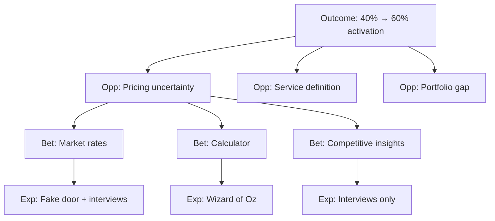

# Product Strategy

> **Design Skills package.** This skill comes from the Design Harness and works on its own. If a path it mentions isn't in your project, follow [references/standalone-mode.md](references/standalone-mode.md).

Connect user opportunities to business outcomes and solution bets. Make
strategy explicit and testable.

**Invoke in Cursor:** "build an OST", "opportunity solution tree",
"connect needs to outcomes", "which opportunities to pursue"

---

## What this does

Builds **Opportunity Solution Trees** (OST) and other strategy frameworks to
connect:
- **Outcome** (business metric to move)
- **Opportunities** (user needs/pains/desires that connect to that outcome)
- **Solution bets** (multiple ways to serve each opportunity)
- **Experiments** (cheapest tests of each bet's core assumption)

Not a feature list. Not a roadmap. This is about **making choices
defensible** before building anything.

---

## When to use it

**Use product-strategy when:**
- Have a business outcome but unclear which user opportunities connect to it
- Have user needs but unclear which to prioritize
- Need to generate solution bets for an opportunity
- Need to identify cheapest experiments to test assumptions
- Strategy feels like "exec said so" instead of explicit reasoning

**Don't use it when:**
- Still gathering user research (do `research-agent` first)
- Outcome itself is unclear (do `okr-goal-setting` first)
- Already know what to build and just need sequencing (do
  `roadmap-prioritization`)
- Building/iterating, not strategizing

---

## Frameworks available

Pick the framework that fits the live decision:

| Framework | Use it when |
|-----------|-------------|
| **Opportunity Solution Tree** (Teresa Torres) | Default. Connects outcome → opportunity → bet → experiment explicitly. Good for ongoing discovery. |
| **Solution bets** | For a chosen opportunity: generate multiple bets, name key assumption for each |
| **Experiments** | Cheapest test of a bet's core assumption (days, not months) |
| **Impact mapping** (Gojko Adzic) | B2B with multiple stakeholders who each must change behavior |
| **Jobs portfolio mapping** | Many job stories — decide which to target by frequency, severity, strategic fit. **Write the stories first** with `research-artifacts` Mode 5; this framework only ranks them. |
| **Kano analysis** | Sort candidate features into hygiene, performance, and delight |
| **HEART / North Star** | Choosing the outcome metric itself |
| **Wardley mapping** | Positioning depends on where capabilities sit on evolution curve; build/buy/partner |
| **Bundling / unbundling** (Christensen) | Should this product own more of the workflow, or one job precisely? |

---

## Disciplines — what keeps strategy honest

Apply these to whatever you produce:

### The outcome is measurable, meaningful, and bounded

Not "grow the product" but "increase users who activate in the first 30
days." One outcome per tree.

**Measurable:** Has a number and current baseline
**Meaningful:** Connects to business goal (revenue, retention, efficiency)
**Bounded:** Time-boxed and scoped to one metric

### Opportunities are customer needs/pains/desires — anchored to a journey moment

First-person, problem-space statements ("I don't know which streaming
service has this movie"), not job stories and not features.

**Apply the flip test:** If you can restate it as a feature, it's a
solution in disguise. Keep them specific, not generic.

**Group opportunities by journey moment** — the forcing function that
exposes vague opportunities and surfaces moments left unaddressed.

### Every opportunity connects to the outcome

If serving it wouldn't move the outcome, it doesn't belong in this tree.

Challenge: "How exactly does solving this opportunity move the outcome
metric?"

### Every bet names its riskiest assumption

And there's more than one bet per opportunity — resist early convergence.

**Riskiest assumption:** The thing that, if wrong, makes the bet fail.
Usually about user behavior ("users will...") or technical feasibility
("we can build...").

### Every experiment is the cheapest way to test the core assumption

Days, not months. Prototype, fake door, concierge, targeted interview,
data analysis — whatever gets evidence fastest.

**Not a full build.** Experiment ≠ MVP. Experiment = "what's the smallest
thing that tests the riskiest assumption?"

---

## Step 0 — Settle the outcome (required)

Before building the tree, the outcome must be explicit.

Ask:
1. **What business metric are you trying to move?**
2. **What's the current baseline?**
3. **What's the target and by when?**

If unclear, route to `okr-goal-setting` first. OST needs a measurable
outcome to work backward from.

**Push for specificity:**
- Bad: "Improve onboarding"
- Good: "Increase signup → first booking from 40% to 60% within 90 days"

---

## Step 1 — Map opportunities (grouped by journey moment)

For the outcome above, identify **user opportunities** (needs, pains,
desires) that genuinely connect to it.

**Sources:**
- User research (`research-agent`, `research-synthesis`, `insight-writer`)
- Job stories (`research-artifacts`)
- Domain knowledge (`org-pack-builder`)
- Analytics gaps (where users drop off)

**Format:** First-person, problem-space statements
- "I don't know what to charge for my services" (pricing uncertainty)
- "I'm not sure how to describe what I do" (service definition)
- "I don't have photos of my work yet" (portfolio gap)

**Group by journey moment:**
```
Signup → Setup (profile/services/pricing) → First booking → Delivery
```

This forcing function surfaces:
- Vague opportunities that don't tie to a moment
- Moments with no opportunities (gaps)
- Opportunities in the wrong order

**Apply the flip test:** Can this be restated as a feature? If yes, it's a
solution in disguise.

---

## Step 2 — Generate solution bets (multiple per opportunity)

For each opportunity you're considering, generate **multiple solution
bets** — different ways to serve that opportunity.

**Format:** "We could [solution], which we believe would [serve the
opportunity] because [reasoning]."

**Example for "I don't know what to charge":**
1. **Show market rate suggestions** — display avg rates for similar
   services in their area. Belief: seeing what others charge reduces
   uncertainty.
2. **Price calculator** — guide based on service type, experience,
   location. Belief: structured input feels more confident than guessing.
3. **Competitive pricing insights** — show where their price sits vs
   competitors. Belief: relative positioning is more useful than absolute
   numbers.

**Why multiple bets:** Early convergence on one idea skips better
alternatives. Aim for 2-4 bets per opportunity before picking.

---

## Step 3 — Name the riskiest assumption (per bet)

For each bet, identify **the core assumption** — the thing that, if wrong,
makes the bet fail.

| Bet | Riskiest assumption |
|-----|---------------------|
| Show market rate suggestions | Providers trust crowd-sourced data as accurate |
| Price calculator | Providers can accurately self-assess their experience level |
| Competitive pricing insights | Providers care about competitive positioning (vs absolute profit) |

This is what the experiment tests.

**For bets involving growth loops, notifications, pricing, defaults, or
anything that shapes user behavior at scale:** also name at least one
**ethical assumption** using `references/shared/ethical-design-check.md`
(harm / access / sustainability). Treat it as a leap-of-faith assumption
like any other — testable, not just a stated concern. Skip this for
bets with no behavioral-shaping or scale dynamic (e.g. a straightforward
utility feature).

---

## Step 4 — Design experiments (cheapest tests)

For the most promising bet(s), design the **cheapest experiment** that
tests the riskiest assumption.

Not a full build. Not an MVP. The smallest thing that gets evidence.

**Experiment types:**

| Type | What it tests | Days to run |
|------|---------------|-------------|
| **Fake door** | Do users want this? (click/interest) | 3-5 days |
| **Concierge** | Can we deliver this manually? | 1-2 weeks |
| **Wizard of Oz** | Does the value prop work? | 1-2 weeks |
| **Prototype** | Can users complete the task? | 1 week |
| **Targeted interview** | Does the assumption hold? | 3-5 days |
| **Data analysis** | What does existing data say? | 1-3 days |
| **Spike** | Is this technically feasible? | 3-5 days |

**Example experiment for "Show market rate suggestions":**
- **Fake door test:** Add "See suggested rates" button on pricing setup.
  Track clicks. Interview 5 who clicked: "What were you hoping to see? Would
  you trust crowd-sourced rates?"
- **Days:** 5 (3 days data + 2 days interviews)
- **Tests:** Do providers want rate suggestions? Would they trust them?

---

## Step 5 — Prioritize opportunities (explicit criteria)

Which opportunities to pursue first?

**Score on:**
1. **Opportunity size** — how many users hit this? how severe?
2. **Outcome connection** — how directly does this move the metric?
3. **Evidence strength** — is this sourced or assumed?
4. **Bet clarity** — do we have promising, testable bets?
5. **Experiment cost** — can we test cheaply?

**Output:** Prioritized list with reasoning for each placement.

Not a numeric black box — show the reasoning.

---

## Output format: Opportunity Solution Tree

```markdown
## Opportunity Solution Tree — [outcome-name] — YYYY-MM-DD

### Outcome
**Metric:** Increase signup → first booking from 40% to 60%
**By when:** 90 days
**Why this metric:** Activation is leading indicator for revenue; current
40% is below industry benchmark

---

### Opportunities (grouped by journey moment)

**Journey moment: Setup (profile/services/pricing)**

1. **"I don't know what to charge"** (pricing uncertainty)
   - Size: 60% of stalled signups cite pricing as blocker (survey, 2026-08)
   - Connection: Pricing setup is last step before "go live"

2. **"I'm not sure how to describe my services"** (service definition)
   - Size: 40% edit service descriptions 3+ times (analytics)
   - Connection: Clear services → confident "go live"

3. **"I don't have photos of my work yet"** (portfolio gap)
   - Size: 25% leave portfolio empty (analytics)
   - Connection: Visual proof → confidence to go live

**Journey moment: First booking**
[Other opportunities...]

---

### Solution bets (for opportunity #1: pricing uncertainty)

**Bet 1: Show market rate suggestions**
- **What:** Display avg rates for similar services in their area
- **Belief:** Seeing what others charge reduces uncertainty
- **Riskiest assumption:** Providers trust crowd-sourced data as accurate
- **Experiment:** Fake door + 5 interviews (5 days)

**Bet 2: Price calculator**
- **What:** Guided questions → suggested rate
- **Belief:** Structured input feels more confident than guessing
- **Riskiest assumption:** Providers can self-assess experience accurately
- **Experiment:** Wizard of Oz (manual calculation) with 10 users (1 week)

**Bet 3: Competitive pricing insights**
- **What:** Show where their price sits vs competitors
- **Belief:** Relative positioning more useful than absolute
- **Riskiest assumption:** Providers care about positioning vs absolute
  profit
- **Experiment:** Interview 10 providers: "Do you set prices relative to
  competitors or based on costs?" (3 days)

---

### Priority
1. **Opportunity #1 (pricing)** — highest size + outcome connection +
   testable bets
2. **Opportunity #2 (service definition)** — high frequency but bets less
   clear
3. **Opportunity #3 (portfolio)** — lower severity (can go live without)

**Next step:** Run Bet 1's fake door experiment (5 days), then decide
whether to build, pivot, or test another bet.
```

---

## Alternative format: Mermaid diagram



---

## Integration with other skills

**Depends on (before):**
- **design-kickoff** — often runs product-strategy as part of Step 1/2
- **research-agent** — surfaces user needs that become opportunities
- **okr-goal-setting** — settles the outcome metric

**Feeds into (after):**
- **roadmap-prioritization** — uses OST priority for sequencing
- **conceptual-model** — bets often require defining objects
- **ui-agent** — experiments that need prototypes

**Related:**
- **assumption-mapper** — separates known from believed before strategy
- **`references/shared/ethical-design-check.md`** — harm/access/sustainability check for bets with a behavioral-shaping or scale dynamic (Step 3)
- **design-kickoff** — Step 1.5 method recommendation may route here

---

## Other strategy frameworks (Step 1 alternatives)

### Impact Mapping (for B2B / multi-stakeholder)

When the outcome requires multiple actors to change behavior:

```
Goal: Reduce time-to-close for sales deals

Who (actors):
├─ Sales reps
├─ Prospects
└─ Internal approvers

Impacts (behavior changes):
├─ Sales reps: Spend less time on unqualified leads
├─ Prospects: Self-qualify earlier in funnel
└─ Approvers: Review proposals faster

Deliverables (what we build):
├─ Lead scoring dashboard
├─ Self-serve qualification quiz
└─ Approval workflow automation
```

### Kano Analysis (feature prioritization)

Sort candidate features into:
- **Hygiene** (expected; absence causes dissatisfaction)
- **Performance** (more is better; linear satisfaction)
- **Delight** (unexpected; presence creates satisfaction)

Survey users: "How would you feel if we had X? / didn't have X?"

### HEART / North Star (choosing the metric)

When the outcome itself is unclear:

**HEART** (Google):
- Happiness (satisfaction, NPS)
- Engagement (usage frequency, depth)
- Adoption (new user activation)
- Retention (churn, return rate)
- Task success (completion, time, error rate)

**North Star** (Amplitude): One metric that predicts long-term success.
Example: "Weekly active providers who complete at least one booking"

---

## Forbidden

- Inventing opportunities not grounded in user research
- Skipping multiple bets (early convergence on one idea)
- Treating experiments as full builds
- Prioritizing by opinion instead of explicit criteria
- Building before testing the riskiest assumption
- Using this for roadmap sequencing (that's `roadmap-prioritization`)

---

## What happens next

After building the OST:

1. **Run experiments** (days, not months)
2. **Evaluate results** — did the assumption hold?
3. **Decide:** Build the bet, pivot to another bet, or abandon the
   opportunity
4. **If building:** Route to `conceptual-model` (define objects) then
   `ui-agent` (build screens)

OST is a decision-making tool, not a build plan. It makes strategy
explicit and testable.

---

## Related skills

- **design-kickoff** — often calls product-strategy in Step 1/2
- **okr-goal-setting** — settles the outcome metric first
- **research-agent** — provides user needs that become opportunities
- **assumption-mapper** — separates known from believed before strategy
- **roadmap-prioritization** — sequences OST priorities into roadmap
- **conceptual-model** — defines objects the bets require
- **ui-agent** — builds experiments that need prototypes

---

## Self-improvement loop

After running this skill, reflect:

1. **Which opportunities were most valuable to surface?**
2. **Which bet assumptions were hardest to identify?**
3. **Which experiments were cheapest and most informative?**
4. **What would you structure differently next time?**

Capture in `learnings.md`
